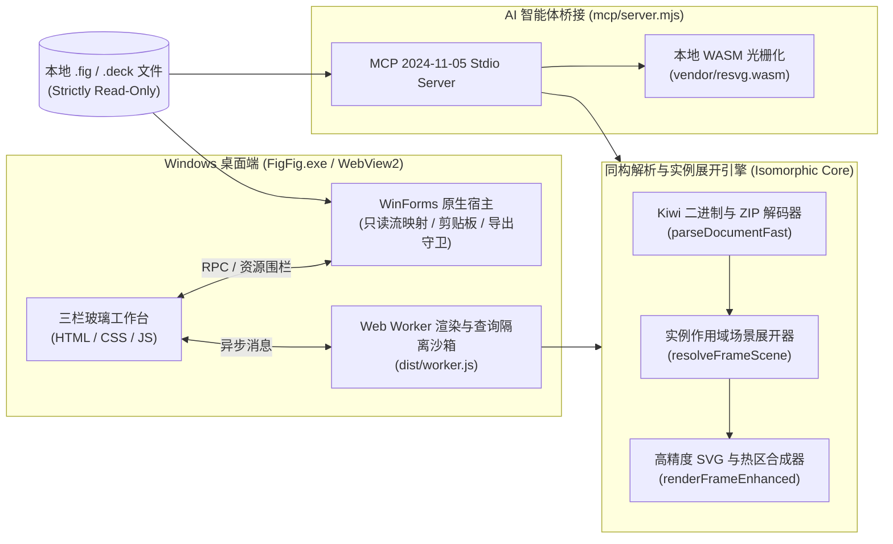

# FigFig · 本地 `.fig` 只读极速查看器与 MCP 桥接服务


> **本地设计，轻快查看。**  
> **FigFig** 是一款面向产品经理、前端与客户端工程师、以及 AI 编码智能体（Coding Agents）的 **Windows 原生本地 `.fig` / `.deck` 只读查看器与 MCP（Model Context Protocol）协议服务**。无需联网、无需登录云端账号，即可在本地毫秒级解析设计归档、预览画板、点选测量图层、提取无损原图、导出矢量 SVG / 高清 PNG / 离线原尺寸 HTML，并通过标准 `MCP 2024-11-05` 协议供 VS Code Copilot、Claude Desktop、Cursor 等 AI 客户端直接读取设计规格。

---

## 免责与工程边界说明

1. **非官方工具声明（Trademark Disclaimer）**：`Figma` 是 Figma, Inc. 的注册商标。**FigFig 是独立的非官方（Unofficial）开源工具，与 Figma, Inc. 不存在任何隶属、授权、合作或背书关系。**
2. **只读文件安全（100% Read-Only）**：FigFig 使用操作系统级只读文件流（`FileAccess.Read`）打开 `.fig` / `.deck` 源文件，自动计算并核验 `SHA-256` 摘要，并在导出层硬性拦截对 `.fig` / `.deck` 扩展名的覆盖写入，确保源设计文件零字节改动。
3. **兼容预览而非官方像素级无损认证**：FigFig 基于本地 Kiwi 二进制解码与实例作用域（Instance-Scoped）SVG 合成引擎渲染画板。源文件字节不变或 SVG 成功生成不代表与 Figma 官方云端 WebGL 渲染器逐像素 100% 一致；对于未内置字形轮廓的缺失字体、复杂混合模式、特殊背景滤镜或动态交互，可能存在视觉近似（详见文末「渲染兼容性边界」）。

---

## 核心特性一览

| 能力维度 | 核心特性说明 |
| --- | --- |
| **极速本地解析** | 原生支持 `.fig` / `.deck`（ZIP 归档与 `fig-kiwi` 二进制流），内置 256 MiB 文件上限与 ZIP 膨胀安全护栏，50 MB 级大型设计稿本地秒级解析。 |
| **实例级场景展开** | 递归展开多层 `INSTANCE` / `SYMBOL`、组件属性赋值（`TEXT_DATA` / `VISIBLE` / `OPACITY` / `OVERRIDDEN_SYMBOL_ID` / `SLOT_CONTENT_ID` 内容槽）、完整 `guidPath` 覆盖链与 `derivedSymbolData` 派生字形布局。 |
| **矢量与几何保真** | 完整解码字形与路径中的移动/直线/二次贝塞尔（`Q`）/三次贝塞尔（`C`）指令；支持 `ODD / EVENODD` 奇偶镂空规则、独立四边描边、非等值四角圆角、矢量/布尔运算渐变填充与蒙版裁剪。 |
| **交互式画布与测距** | 支持鼠标滚轮锚点缩放（`5% ~ 1600%`）、空格拖拽平移、视口自适应防抖锁定（`Fit to Screen`）、图层悬停高亮、点击穿透选取子图层，以及按住 `Alt` 键或开启测距模式的实时像素间距测量。 |
| **清透玻璃三栏工作区** | 采用清透多色玻璃（Frosted Glass）视觉系统，内置 **浅色（Light）/ 暖色（Sepia）/ 暗色（Dark）** 三套主题及自适应四色风车图标；左右分栏支持鼠标拖拽、键盘微调、双击复位与跨会话宽度记忆，左侧画板长标题自然换行不遮挡。 |
| **开发标注与一键复制** | 右侧检查器实时展示选中节点的几何尺寸、`Auto-Layout`（方向/间距/内边距）、填充与描边色值（HEX / RGBA）、字形轮廓统计及参考 CSS 代码，支持一键复制文案、CSS 与完整节点 JSON。 |
| **多格式安全导出** | 支持导出 **矢量 SVG**、**1x ~ 4x 超采样高清 PNG**（超大图自动按单边 `16,384 px` 与总像素 `32 Mi px` 预算等比例限流）、**单文件离线原尺寸 HTML**（内嵌 Base64 矢量图与严格 `CSP` 策略，零外部依赖），以及 **1:1 零重编码提取内嵌原图资源**。 |
| **内置 MCP 协议服务** | 零外部 npm 依赖实现 `MCP 2024-11-05 (stdio)` 服务端（`mcp/server.mjs`），提供 7 个只读工具，让 AI 编程助手直接检索画板、读取 UX 文案与布局、获取高清 PNG 视觉上下文。 |

---

## 系统架构



---

## 快速开始

### 1. 运行环境要求

- **操作系统**：Windows 10 / Windows 11 (x64)
- **系统运行库**：系统自带 `.NET Framework 4.x` 与 `Microsoft Edge WebView2 Runtime`（Windows 11 及主流 Windows 10 均已内置）
- **开发与构建 / MCP 运行时**：Node.js `>= 18`

### 2. 直接启动桌面端

构建完成后，直接双击运行发布目录中的 `FigFig.exe`，或在 PowerShell 中通过命令行打开指定的 `.fig` 文件：

```powershell
# 启动 FigFig（默认加载内置的云原生设计系统示例库）
.\release\FigFig-1.2.0\FigFig.exe

# 启动并直接以只读模式打开指定的本地 .fig 文件
.\release\FigFig-1.2.0\FigFig.exe --open "D:\Designs\your-design-file.fig"
```

### 3. 从源码构建与运行自动化验证

```powershell
# 1. 构建 Web 核心 bundle、多尺寸风车图标与内置示例库 (dist/)
node tools/build.mjs

# 2. 编译原生 Windows x64 可执行程序并打包便携版 ZIP (release/FigFig-1.2.0/)
powershell -NoProfile -ExecutionPolicy Bypass -File tools/build.ps1 -ProjectRoot .

# 3. 运行浏览器 UI 与高分屏防抖/分栏/导出回归测试
node tools/verify-ui.mjs

# 4. 运行原生桌面端 (CDP) + 只读安全守卫 + MCP 协议端到端验证
node tools/verify.mjs
```

---

## 界面工作流与快捷键指南

### 三栏工作区操作

1. **左侧导航栏（页面 / 搜索 / 画板 / 图层树 / 原图包）**：
   - 支持按页面切换、勾选「跨全部页面搜索」或「含内部组件页」，秒级检索画板名、图层名、文本节点与组件属性赋值文案。
   - **长名称完整换行**：默认 `268 px` 宽度下画板与图层长名称自动多行显示，不截断关键页面编号。
   - **原图包提取**：在「原图包」标签页可直接预览 `.fig` 内嵌的所有原始位图，或一键 **1:1 无损提取** 原始字节流（零重编码）。
2. **中间交互式矢量画布**：
   - 支持 **「画布精览」**（单画板无级缩放、点选图层、像素测距）与 **「网格总览」**（整页画板缩略图网格分页浏览）一键切换。
   - **自适应防抖锁定**：处于「适合窗口」模式时，画布自动锁定溢出边界并预留安全内边距，消除长表单画板（如 `1440×1204`）在高分屏下的滚动条临界振荡。
3. **右侧属性与开发标注栏**：
   - 点击画布任意文字、按钮、卡片或图标，右侧即时定位该节点并提供 `X / Y / W / H`、`Auto-Layout` 排版属性、色板色值（点击即复制 HEX）、文本内容预览、推导 CSS 代码及展开后的实例 JSON 数据。
4. **分栏自由拖拽**：
   - 左右两条分隔线支持鼠标拖拽调整宽度、键盘 `←` / `→` 微调（配合 `Shift` 大步进）、`Home` 键或双击分隔线恢复默认宽度，拖拽结果自动持久化到本地存储。

### 快捷键一览

| 快捷键 / 操作 | 功能说明 |
| --- | --- |
| `鼠标滚轮` | 以鼠标指针为中心无级缩放画布（`5% ~ 1600%`） |
| `Space + 左键拖拽` / `中键拖拽` | 平移画布视口 |
| `画布左键点击` | 穿透选中鼠标下的子图层并在右侧展示属性与 CSS |
| `按住 Alt + 悬停` | 测量当前选中图层与鼠标悬停图层之间的上下左右像素间距 |
| `Ctrl + O` | 打开本地 `.fig` / `.deck` 文件（亦支持直接拖入窗口） |
| `Ctrl + F` | 聚焦左侧全局搜索框 |
| `F` | 画板自适应窗口大小（Fit to Screen） |
| `1` | 恢复 `100%` 原始像素比例（`1:1`） |
| `+` / `-` | 放大 / 缩小画布比例 |
| `I` | 切换「点选图层」悬停高亮模式 |
| `G` | 在「画布精览」与「网格总览」之间切换 |
| `?` | 打开快捷键与操作指南弹窗 |

---

## MCP 协议集成（供 AI 编码助手直连读取 UX）

FigFig 内置零外部依赖的 `MCP 2024-11-05 (stdio)` 服务端 `mcp/server.mjs`，支持 AI 客户端直接从本地 `.fig` 文件中检索页面、读取 UX 文案与布局结构、以及渲染画板高清 PNG。

### 1. 配置方式

点击软件顶部工具栏的 **「MCP 协议」** 按钮即可一键复制当前环境的配置 JSON。

#### VS Code (`.vscode/mcp.json`)

```json
{
  "servers": {
    "figfig-design": {
      "type": "stdio",
      "command": "node",
      "args": ["D:/path/to/figfig/mcp/server.mjs"]
    }
  }
}
```

#### Claude Desktop / Cursor (`claude_desktop_config.json`)

```json
{
  "mcpServers": {
    "figfig-design": {
      "command": "node",
      "args": ["D:/path/to/figfig/mcp/server.mjs"]
    }
  }
}
```

> 可选参数：在 `args` 中追加 `["--root", "D:/Designs"]` 可将 MCP 服务允许访问的 `.fig` 文件路径严格限制在指定目录树内（默认允许当前用户主目录与当前工作区目录）。

### 2. MCP 只读工具清单（7 个标准工具）

| 工具名称 | 用途说明 |
| --- | --- |
| `figfig_list_local_files` | 扫描本机 `Downloads`、`Desktop` 及内置示例目录中的 `.fig` / `.deck` 文件清单与字节大小。 |
| `figfig_list_pages` | 只读解析指定 `.fig` 文件，返回 `SHA-256` 指纹、节点总数、内嵌图片数及页面（`CANVAS`）列表。 |
| `figfig_get_frames` | 分页列出指定页面（`pageId`）下的所有可预览画板（`Frames`）及其尺寸。 |
| `figfig_search` | 跨页面秒搜画板名、图层名、原始文字、文字覆盖及组件属性赋值文案（支持按页面过滤）。 |
| `figfig_read_node` | 读取指定节点的坐标尺寸、`Auto-Layout`、填充/描边色值、推导 CSS、组件覆盖记录及子图层列表。 |
| `figfig_render_frame` | 渲染指定画板或组件节点，返回已解析文字清单、SVG 源码及高清 PNG 图像流（供多模态模型直接看图）。 |
| `figfig_compatibility` | 获取文件的 `SHA-256` 校验值、缓存字形轮廓覆盖率及潜在的渲染兼容性风险统计。 |

---

## 目录结构

```text
figfig/
├── assets/                  # 四色折纸风车矢量/位图图标、多尺寸 .ico 与内置示例 .fig
├── licenses/                # WebView2 与第三方运行时许可文件
├── mcp/
│   └── server.mjs           # 零依赖 MCP 2024-11-05 (stdio) 只读协议服务端
├── native/
│   ├── FigFigApp.cs         # Windows x64 WinForms + WebView2 原生宿主窗口与本地资源围栏
│   ├── FigFigStore.cs       # 只读文件流会话管理、SHA-256 校验与导出扩展名白名单守卫
│   └── FigFigTests.cs       # C# 原生只读与防覆盖安全自检套件
├── src/
│   ├── index.html           # 三栏玻璃工作台视图结构
│   ├── app.css              # 清透玻璃主题系统（Light / Sepia / Dark）与响应式样式
│   ├── app.js               # 前端控制器、可拖拽分栏、无抖动缩放视口与导出工作流
│   ├── engine-ext.js        # 实例作用域场景展开器、几何/渐变/蒙版/边框增强渲染与全文检索
│   └── worker-entry.js      # 同构 Web Worker / Node RPC 入口
├── tools/
│   ├── branding.mjs         # 四色折纸风车图标与多尺寸 .ico 构建脚本
│   ├── build.mjs            # 核心 Worker bundle 组装与内置示例归档生成器
│   ├── build.ps1            # 原生测试、C# 编译、资源打包与便携版 ZIP 构建脚本
│   ├── verify-ui.mjs        # 浏览器端 UI 交互、分栏、高分屏防抖与导出自动化测试
│   └── verify.mjs           # 原生桌面端 (CDP)、剪贴板与 MCP 7 工具端到端验收套件
├── vendor/                  # OpenFig / Kiwi / fflate / fzstd 基础 bundle 与本地 resvg WASM
├── LICENSE                  # MIT 开源许可证
├── THIRD-PARTY-NOTICES.txt  # 第三方开源组件声明与非官方商标免责声明
└── package.json             # 项目元数据与脚本入口
```

---

## 渲染兼容性边界与隐私说明

- **视觉兼容性边界**：
  1. **字体与字形**：优先使用 `.fig` 内部缓存的派生矢量字形轮廓（`derivedTextData.glyphs`）进行路径级还原；若节点缺失缓存字形或因覆写失效，将回退至本机系统字体排版。
  2. **高级图形特性**：复杂的背景毛玻璃滤镜（`BACKGROUND_BLUR`）、特殊图层混合模式、角度/菱形渐变（自动降级取首色标）以及动态原型交互连线仅做静态近似展示。
  3. **CSS 代码推导**：右侧属性栏生成的 CSS 仅供前端开发参考，不等同于 Figma 官方 Dev Mode 输出。
- **完全本地与隐私安全**：
  - 桌面端内置 WebView2 网络请求围栏，仅放行本地虚拟主机（`https://figfig.local/` 与 `https://figfig-files.local/`）、`data:` 与 `blob:` 资源，拦截一切外部网络请求。
  - 当你主动通过 MCP 客户端调用 `figfig_render_frame` 或 `figfig_read_node` 时，解析出的文字或 PNG 图像会经由本地 `stdio` 传递给你的 AI 客户端，请遵循所在组织的数据合规要求。

---

## 开源许可 (License)

本项目主体代码采用 **[MIT License](LICENSE)** 开源分发。  
项目中包含或适配的第三方开源组件（`OpenFig`、`fflate`、`fzstd`、`kiwi-schema`、`@resvg/resvg-wasm` 及 `Microsoft.Web.WebView2`）各自遵循其原始许可证条款，详见 **[THIRD-PARTY-NOTICES.txt](THIRD-PARTY-NOTICES.txt)**。
